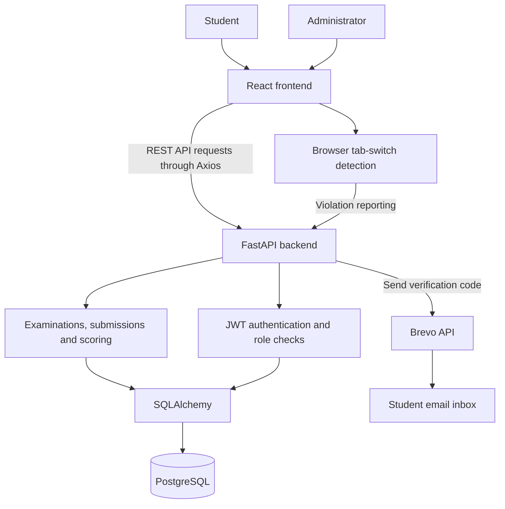
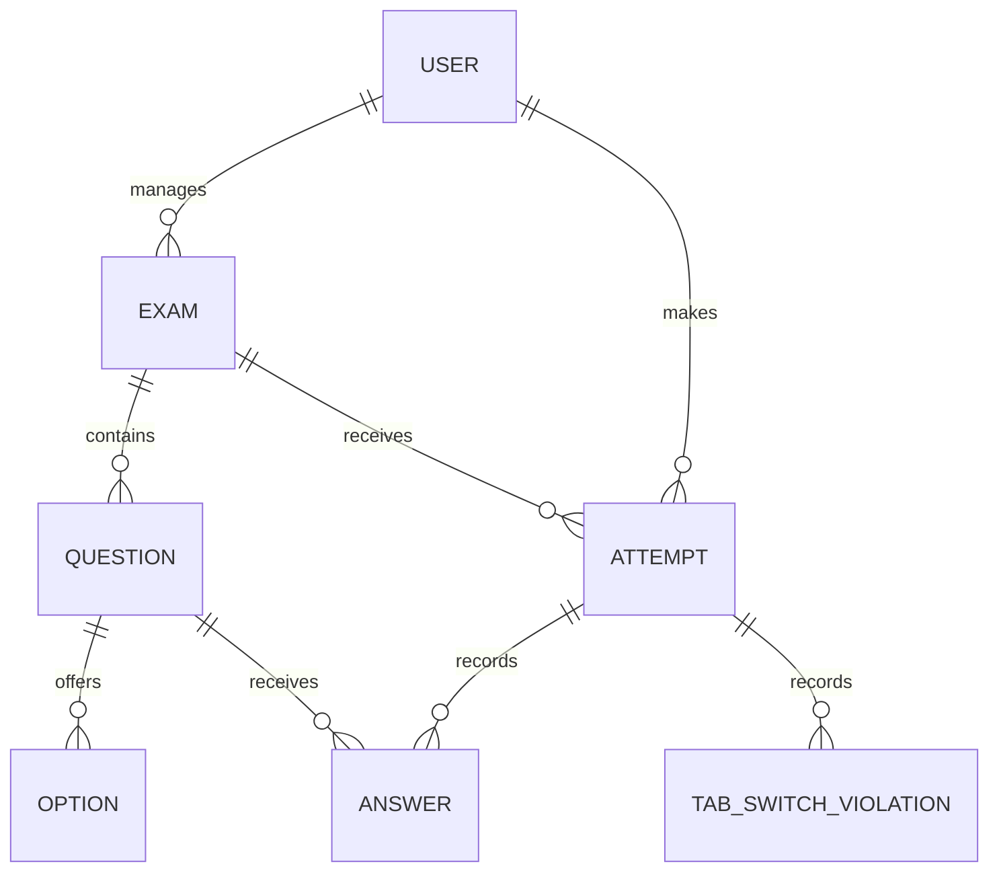

# Online Examination System

## Project Overview

Online Examination System is a full-stack college project for conducting and managing examinations through a web browser. It provides separate interfaces for students and administrators. Students can register, verify their email, attempt examinations, and view their scores. Administrators can manage examinations, questions, and student results.

The application uses a React frontend, a FastAPI backend, and PostgreSQL for storage. Brevo sends verification codes during registration. Browser tab-switch detection helps monitor examination sessions.

## Key Features

### Students

- Register an account and verify an email address using a verification code.
- Log in and access the student dashboard.
- View available examinations and read examination instructions.
- Attempt multiple-choice examinations and navigate between questions.
- Select or update answers and mark questions for review.
- Track the remaining time using the examination timer.
- Submit answers and view results and scores.

### Administrators

- Log in to a separate administrator dashboard.
- Create and manage examinations and their details.
- Add and manage examination questions.
- View student examination results.

### Examination monitoring

The examination page detects when a student switches tabs or leaves the page. It records these violations and applies the application's examination termination rules. This is a browser-based integrity feature with limited visibility into activity outside the examination page.

## Technologies Used

| Area | Technologies |
| --- | --- |
| Frontend | React, Vite, JavaScript, HTML, CSS |
| API communication | Axios |
| Backend | Python, FastAPI |
| Database operations | SQLAlchemy |
| Database | PostgreSQL |
| Authentication | JSON Web Tokens (JWT) |
| Email verification | Brevo API |
| Development | Git, GitHub, VS Code or another code editor |

## Project Structure

The project is organized into a backend service and a frontend application.

```text
online-examination-system/
├── backend/
│   ├── main.py
│   ├── database.py
│   ├── models.py
│   ├── schemas.py
│   ├── security.py
│   ├── email_service.py
│   ├── requirements.txt
│   └── routes/
│       ├── auth.py
│       ├── admin.py
│       ├── exams.py
│       ├── attempts.py
│       └── results.py
├── frontend/
│   ├── src/
│   │   ├── api/
│   │   ├── components/
│   │   ├── context/
│   │   ├── pages/
│   │   ├── App.jsx
│   │   └── index.css
│   ├── package.json
│   └── vite.config.js
└── .gitignore
```

## Prerequisites

- Python compatible with the backend dependencies
- Node.js and npm
- PostgreSQL installed and running
- Git or a downloaded copy of the repository
- A Brevo account, API key, and configured sender email address
- A code editor

Check the local installations:

```bash
python --version
node --version
npm --version
psql --version
```

## Installation and Setup

### 1. Get the project

Download the repository using **Code → Download ZIP** on GitHub and extract it, or use GitHub's **Open with GitHub Desktop** option. Open the project folder in a terminal.

### 2. Prepare PostgreSQL

Start the PostgreSQL service and create a database for the application. For a local database named `examination_system`, run the following in pgAdmin's Query Tool or a PostgreSQL session with permission to create databases:

```sql
CREATE DATABASE examination_system;
```

The backend needs the database host, port, database name, username, and password. PostgreSQL commonly uses port `5432` for local connections.

Database connection and initialization behavior are defined by the backend configuration. A separate migration command is not documented here because the source files were not supplied with this project description.

### 3. Install backend dependencies

From the project root:

```bash
cd backend
python -m venv .venv
```

Activate the environment in Windows PowerShell:

```powershell
.venv\Scripts\Activate.ps1
```

Or on macOS and Linux:

```bash
source .venv/bin/activate
```

Install the backend dependencies:

```bash
python -m pip install -r requirements.txt
```

### 4. Configure the application

The backend requires configuration for the PostgreSQL connection, JWT authentication, and Brevo email delivery. Brevo needs a valid API key and a configured sender address so students can receive verification codes.

Configuration names and loading behavior depend on the backend source. No example variable names are listed here because the exact names were not provided. The same applies to the frontend API address: its configuration is handled by the frontend API module.

Keep local credentials in private configuration, and exclude populated `.env` files from version control. Secrets belong on the backend and must never be included in the frontend bundle.

### 5. Install frontend dependencies

Open another terminal at the project root:

```bash
cd frontend
npm install
```

## Running the Application

Keep PostgreSQL running while using the application.

### Backend

From the `backend` directory, with the virtual environment active:

```bash
python -m uvicorn main:app --reload
```

With Uvicorn's default settings, the API is available at [http://127.0.0.1:8000](http://127.0.0.1:8000). FastAPI's interactive API documentation is normally available at [http://127.0.0.1:8000/docs](http://127.0.0.1:8000/docs), unless disabled or moved by the application.

### Frontend

From the `frontend` directory:

```bash
npm run dev
```

Open the address printed by Vite in the terminal. Its default development address is [http://localhost:5173](http://localhost:5173); another port may be selected if that port is occupied.

## How to Use

### Student workflow

1. Open the application and register a student account.
2. Enter the verification code received by email.
3. Log in and open the student dashboard.
4. Select an available examination and read its instructions.
5. Answer the questions, use the review option where needed, and watch the timer.
6. Stay on the examination page to avoid tab-switch violations.
7. Submit the examination and view the result.

### Administrator workflow

1. Sign in with an administrator account.
2. Open the administrator dashboard.
3. Create or manage an examination and its questions.
4. Review student results after submissions.

Administrator account provisioning is specific to the application. This documentation does not define a default administrator account or password.

### System architecture

The React frontend communicates with FastAPI through REST APIs using Axios. The backend handles authentication, examination management, submissions, scoring, and database operations through SQLAlchemy. Brevo delivers email verification codes.



### Conceptual ER diagram

This diagram describes the main examination concepts. It is a conceptual model pending schema verification, rather than an exact representation of SQLAlchemy tables, columns, or database constraints.



Users act as students or administrators according to their role. An exam contains questions, while an attempt connects a student to an examination and its submitted answers. Violations belong to an examination attempt in this conceptual model. Results may be calculated from attempts without requiring a separate result table.

## Security and Configuration

- JWT is used for authenticated requests.
- Student and administrator operations are separated by role.
- Email verification uses codes delivered through Brevo.
- Database credentials, authentication secrets, and Brevo API keys must remain private.
- Private environment configuration must be excluded from Git. Environment variables do not encrypt secrets by themselves.
- Tab-switch detection provides limited browser-based monitoring; it cannot establish whether all examination activity is legitimate.

## Future Improvements

- Improve mobile layouts and accessibility.
- Add question banks and randomized question order.
- Expand result analysis for students and administrators.
- Improve recovery from interrupted examination sessions.
- Expand automated testing and deployment documentation.
- Implement video and audio proctoring for anti cheating measures. 

---

